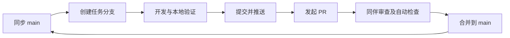

# RobotArmProject：GitHub 多人协作新手指南

仓库地址：[Uesr20251011/RobotArmProject](https://github.com/Uesr20251011/RobotArmProject)

这份指南按“界面一人、运动学一人、轨迹规划一人”的安排编写。第一次可以三个人一起跟着做，先用一处文档改动练习提交和 PR，再开始正式功能开发。

## 1. 先认识几个词

| 名称 | 在本项目中的意思 |
| --- | --- |
| Git | 在自己电脑上记录代码修改历史的工具 |
| GitHub | 存放远程仓库、讨论任务、审查合并代码的网站 |
| Repository / 仓库 | 项目文件以及修改历史 |
| Clone / 克隆 | 把远程仓库连同历史下载到本机，通常只做一次 |
| Branch / 分支 | 从当前代码分出一条工作线，用来开发一个任务 |
| main | 三个人共享的集成分支，保持能编译运行 |
| Commit / 提交 | 在本机保存一组修改记录；单击保存文件还不算提交 |
| Push / 推送 | 把本机提交上传到 GitHub |
| Fetch / 获取 | 查看远程是否有新提交，不直接合并代码 |
| Pull / 拉取 | 把当前分支在远程的新提交拿到本机并整合 |
| PR / Pull Request | 提出“把我的任务分支合并进 main”的申请，大家可审查讨论 |
| Merge / 合并 | 把一个分支的改动整合进另一个分支 |
| Conflict / 冲突 | 两边修改互相重叠，Git 需要人决定怎样保留 |

记住工作顺序：**同步 main → 创建任务分支 → 修改并验证 → Commit → Push → PR → 同伴审核 → 合并 → 再同步 main**。



## 2. 三个人怎样分工

| 角色 | 主要目录 | 分支名示例 |
| --- | --- | --- |
| 界面开发者 | RobotArmUI/ | feature/ui-parameter-panel |
| 运动学开发者 | Kinematics/，牵头维护 Common/ | feature/kinematics-inverse-solve |
| 轨迹规划开发者 | Trajectory/ | feature/trajectory-joint-planning |

公共类型在 Common/，导入输出配置在 commonlibdll/*.props。更改公共接口前，先在 Issue 写明“哪些参数要变、谁的调用会受影响”，三人达成一致后再改。发布目录中的头文件是构建副本，直接改源码目录的头文件。

每次完成一个小任务就提交一个 PR。不要三个人共用一个任务分支，也不用每个人复制一份独立仓库。成为协作者后，共用此仓库即可。

## 3. 仓库所有者先做一次邀请

仓库设为公有，只代表大家都能看代码；另外两人要直接推送分支，仍需要加入为协作者。

1. 另外两人注册 GitHub 账号，把准确的用户名给仓库所有者。
2. 所有者打开仓库网页，进入 **Settings → Collaborators → Add people**。
3. 搜索用户名，核对账号后发送邀请。
4. 受邀者登录自己的账号，接受 GitHub 通知或邮件里的邀请。

这是邀请权限操作，不会自动把代码下载到成员电脑。步骤来源：[GitHub 官方邀请说明](https://docs.github.com/en/repositories/managing-your-repositorys-settings-and-features/repository-access-and-collaboration/inviting-collaborators-to-a-personal-repository)。

## 4. 每个人配置自己的电脑

建议新手使用 GitHub Desktop 管理分支和提交，VS 2022 用来写代码和调试，两者操作同一份本地文件。

准备 GitHub 账号、[GitHub Desktop](https://desktop.github.com/)、[Git for Windows](https://git-scm.com/downloads/win)、VS 2022 C++ 桌面开发组件以及 Qt 6.11.2 MSVC 2022 64-bit。不要选择 MinGW kit，本项目 DLL 用 MSVC 构建。

### 4.1 首次克隆

在 GitHub Desktop 登录自己的账号，选择 **File → Clone repository → URL**，填入：

```text
https://github.com/Uesr20251011/RobotArmProject.git
```

本地路径选择一个新的空目录，例如 `D:\Project\RobotArmProject`，然后 Clone。不要把项目放进另一人的压缩包副本里。

**仓库所有者当前这台电脑已经有本地 Git 仓库，无需再次克隆。** 使用 Desktop 的 **File → Add local repository**，选择现有项目目录即可。

### 4.2 第一次编译

在项目根目录打开 PowerShell，配置自己机器的 Qt 路径并执行：

```powershell
# 按实际安装位置修改；末尾必须是 msvc2022_64。
$env:QT_ROOT = 'E:\Tools_E\QtOrginal\6.11.2\msvc2022_64'
.\scripts\Build.ps1 -Configuration Debug -Test
```

路径只对当前终端窗口生效，每次新开终端可以重新设置。遇到脚本执行策略提示时，可执行 `Set-ExecutionPolicy -Scope Process Bypass` 后重试，只影响当前窗口。

成功后，用 VS 打开 **RobotArmProject.sln**，选择 **Debug / x64**，右键 RobotArmUI → 设为启动项目，再启动。需要从命令运行时：

```powershell
.\build\bin\x64\Debug\RobotArmUI.exe
```

日常按分工可以打开更小的解决方案：界面使用 **RobotArmUI/RobotArmUI.sln**，运动学使用 **Kinematics/Kinematics.sln**，轨迹规划使用 **Trajectory/Trajectory.sln**，公共库使用 **Common/Common.sln**。三个库的入口都包含自己的依赖库，克隆后可直接用 VS 打开，不要求 Qt；只做库开发的成员可以跳过本节的 Qt 安装和界面生成，改为运行 `scripts/Test-LibrarySolutions.ps1 -Configuration Debug` 验证库构建。DLL 本身不能作为程序启动，运行调试时使用测试程序或界面作为宿主。

Qt 生成的 vcxproj 带本机路径，因此 Git 中保留 `.pro` 和使用相对路径的界面 sln，界面开发者首次克隆后运行构建或生成脚本。新增 `.cpp/.h/.ui` 时，在 `.pro` 对应列表登记，再关闭 VS、运行 `Generate-VS.ps1` 并重新打开解决方案。DLL 新增文件则通过 VS 加入对应原生库项目，并提交相应 `.vcxproj`。

## 5. 每个任务的完整流程：以运动学为例

### 第一步：先登记任务

在仓库网页 **Issues → New issue** 新建任务，例如“实现末端坐标逆解”。写清负责人、输入输出和验收条件。被指派的人尚未加入仓库时，先在正文写角色名。

本项目示例验收条件：

- 可达点能返回对应构型的关节角。
- 不可达点返回 false，并保持输出参数不变。
- 用正解回代检查末端位置误差。
- Debug 和 Release 构建通过。

### 第二步：更新 main，再建分支

1. 确保上一任务的修改已提交，Desktop 的 Changes 列表没有未处理改动。
2. 切换 **Current Branch → main**。
3. 点击 **Fetch origin**，如果出现 **Pull origin**，继续点击它。
4. 从最新 main 创建新分支，命名 `feature/kinematics-inverse-solve`。

一个任务用一个分支。修改代码前先确认 Current Branch 显示任务分支。

分支操作可参考 [GitHub Desktop 分支管理](https://docs.github.com/en/desktop/making-changes-in-a-branch/managing-branches-in-github-desktop)。

### 第三步：开发并在本机验证

用 VS 修改 Kinematics 的源码，必要时补充 tests。保存文件后执行：

```powershell
.\scripts\Build.ps1 -Configuration Debug -Test
.\scripts\Build.ps1 -Configuration Release -Test
```

注意：初始测试有“骨架返回失败”的断言。真正实现逆解或轨迹规划时，要把对应断言改为算法正确性测试。出现测试失败，应判断是旧骨架预期需要更新，还是新算法有问题。

### 第四步：Commit，把改动记入本机历史

回到 Desktop 的 Changes 页面，逐个查看修改文件。确认没有 DLL、EXE、build 目录或自己的本机设置。

在 Summary 写明改动，例如 `feat(kinematics): implement endpoint inverse solver`，再点击 **Commit to feature/kinematics-inverse-solve**。一次提交尽量只表达一件事，可以先做多个小提交，再一起发 PR。

### 第五步：Push，把分支上传

第一次上传分支点击 **Publish branch**；后续提交点击 **Push origin**。

**Commit 只在本机，Push 后同伴才能在 GitHub 看到。** 上传分支也不会自动把代码合并到 main。

### 第六步：发起 PR，请同伴检查

在 Desktop 选择 **Preview Pull Request / Create Pull Request**，或在仓库网页进入 **Pull requests → New pull request**。确认目标为 **base: main**，来源为自己的任务分支。

标题写“实现末端坐标逆解”，正文使用仓库提供的模板，说明改动、怎样验证、是否影响公共接口。有对应 Issue 时在正文写 `Closes #实际编号`，把“实际编号”换成任务编号。

在 Reviewers 中选择另一位协作者。如果还没开发完成，创建 Draft PR，正文说明尚缺什么。

关于 PR 的官方步骤：[从 GitHub Desktop 创建 PR](https://docs.github.com/en/desktop/working-with-your-remote-repository-on-github-or-github-enterprise/creating-an-issue-or-pull-request-from-github-desktop)。

### 第七步：审查、修改、再推送

同伴打开 PR 的 **Files changed** 查看代码，重点看公共接口、边界条件和测试，提出评论。需要改动时，在原任务分支继续修改、Commit、Push，原 PR 会自动更新，不用新建第二个 PR。

PR 页面还会显示自动构建结果。红色检查先打开详情查看具体错误，不能把“本机能编译”当作忽略失败的理由。检查完成且同伴同意后，再合并。

### 第八步：合并后，三个人都同步

使用 PR 页面的合并按钮，团队统一选择 **Squash and merge**，让一个小任务在 main 中形成清晰的一次记录。确认后可以删除已合并的远程任务分支。

每个人随后切回 main，Fetch origin，再 Pull origin，获取刚合并的代码。下一个任务从更新后的 main 创建一个全新分支；不要继续使用已完成并删除的旧任务分支。

## 6. 自己还在开发，别人已经合并了怎么办

“拉取当前功能分支”和“把 main 合进功能分支”是两件事。先提交手里的修改，保持 Changes 干净：

1. 切换 main，Fetch origin，再 Pull origin，更新本地 main。
2. 切回自己的功能分支。
3. 在分支菜单中选择把 **main 合并到当前功能分支**，仔细确认方向。
4. 重新编译和验证，随后 Push origin，继续原 PR。

如果冲突，按下一节处理。官方说明：[同步分支与合并其他分支](https://docs.github.com/en/desktop/working-with-your-remote-repository-on-github-or-github-enterprise/syncing-your-branch-in-github-desktop)。

## 7. 发生冲突时怎么处理

冲突通常是两个人改了同一段内容。先看 Desktop 提示的文件，用编辑器打开；不要凭“全选当前”或“全选传入”来解决。

文本中可能看到：

```text
    <<<<<<< HEAD
    自己分支的内容
    =======
    main 合进来的内容
    >>>>>>> main
```

与另一位修改者确认意图，保留正确的组合版本，删除三种冲突标记。然后保存、编译、测试，再在 Desktop 完成合并提交并推送。

不确定时，先暂停合并并找对方一起看。命令行合并尚未完成时，可以用 `git merge --abort` 回到合并前；前提是合并前已提交自己的修改。它不是删除历史或随意撤销代码的通用按钮。

减少冲突的做法：各改各的模块；公共头文件修改提前沟通；任务分支不要拖太久；不要整文件无意义重排格式。

## 8. 命令行速查：可替代 Desktop 操作

以下命令在项目根目录依次执行，分支名按实际角色和任务调整。Desktop 和命令行选择一种做同一步即可，无需重复提交。

首次克隆（已有仓库的所有者跳过）：

```powershell
git clone https://github.com/Uesr20251011/RobotArmProject.git
cd RobotArmProject
```

检查身份：

```powershell
git config user.name
git config user.email
```

如果没有身份，使用本机自己的真实设置。名字和邮箱可在 Desktop 的 Git 设置中填写；邮箱可使用自己 GitHub 账号提供的 noreply 地址，不要复制同伴的身份。

每次开始新任务：

```powershell
git status
# 确保没有未提交改动，再切换分支。
git switch main
git pull --ff-only origin main
git switch -c feature/kinematics-inverse-solve
```

修改并验证后：

```powershell
git diff
git add Kinematics/Kinematics.cpp tests/ArchitectureSmoke.cpp
git diff --cached
git commit -m "feat(kinematics): implement endpoint inverse solver"
git push -u origin feature/kinematics-inverse-solve
```

示例只暂存两个文件；新增文件或工程修改按实际路径加入。然后到网页创建 PR。后续同一分支的提交，直接 `git push`。

开发中同步 main（先提交自己的修改）：

```powershell
git fetch origin
git merge origin/main
# 若有冲突，编辑解决后再执行 git add 对应文件、git commit。
# 合并成功后重新验证，再推送。
git push
```

PR 合并后开始下一个任务：

```powershell
git switch main
git pull --ff-only origin main
git switch -c feature/kinematics-next-task
```

不要使用 `git push --force`、`git reset --hard` 或删除项目目录来尝试“修复”协作问题。先保存现有改动，检查分支和错误提示。

## 9. 常见问题

| 现象 | 检查和处理 |
| --- | --- |
| 同伴找不到我的改动 | 是否 Commit 后又 Push？是否在正确分支或 PR 中查看？ |
| Push 提示无权限 / 403 | 检查登录账号，确认已接受协作者邀请；公有不等于可直接推送 |
| 下载 ZIP 后无法正常协作 | ZIP 没有 Git 历史，改用 Clone |
| 登录时要求认证 | 优先用 Desktop 的浏览器登录，不要把 GitHub 密码填进源码或脚本 |
| main 拉取被拒绝，出现无法快进 | 可能在本地 main 提交了代码；先建备份分支保留提交，再请同伴一起整理，不要强制推送 |
| VS 提示找不到 RobotArmUI.vcxproj | 首次克隆后先运行 Generate-VS.ps1 或 Build.ps1 |
| 找不到 Common.lib 或头文件 | 构建整个解决方案，确认依赖库编译成功；不要手工混拷不同配置的二进制 |
| Qt 提示平台插件错误 | 运行完整 Build.ps1 重新部署；确认 platforms/qwindows[d].dll 在程序目录，别只拷一个 EXE |
| 改动列表有大量 DLL 或 VS 缓存 | 查看 .gitignore 是否被改动；不要强制加入生成文件 |
| 三人改同一个公共头文件 | 先协商签名与参数含义，让一人提交接口变更，合并后其他人同步 |

## 10. 每天的检查清单

开始：确认任务和分支，更新 main，再创建或更新工作分支。

结束：检查改动，编译测试，Commit、Push，在 Issue 或 PR 留下进展和未完成项。

合并前：确认目标是 main、检查通过、同伴审查完成、公共接口变更已沟通。

目前文档中的审核要求是团队约定。仓库所有者可以在分支规则中进一步强制 PR 和至少一次同伴审核，设置后以 GitHub 实际生效规则为准。
