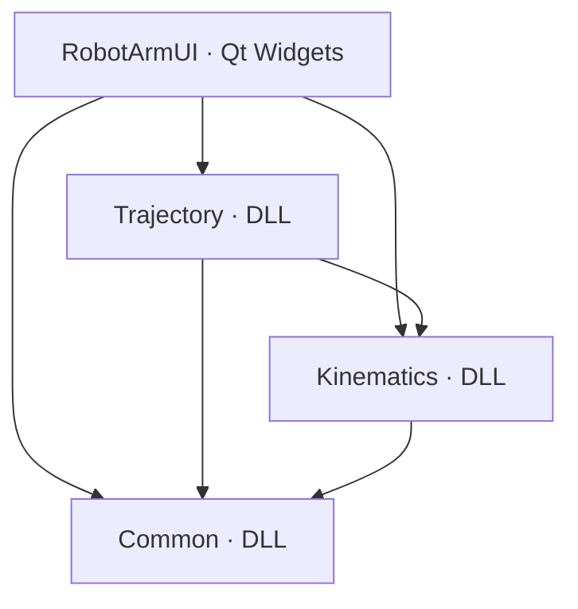

# 架构与接口约定

本仓库按根目录《面向对象作业设计.md》初始化，参考 FaceDetection 的原生 VS DLL、公共属性表和 Qt `.pro` 组织方式。当前交付是可编译、可启动的协作骨架。原始设计保留为历史参考；公共返回值已按 [Issue #2 的确认评论](https://github.com/Uesr20251011/RobotArmProject/issues/2#issuecomment-6379340143) 迁移，当前接口以本文与公共头文件为准。

## 模块与依赖



| 模块 | 职责 | 负责人 |
| --- | --- | --- |
| RobotArmUI | 参数输入、计算操作、机械臂绘制、轨迹展示、动画播放 | 界面开发者 |
| Common | 公共结构体与 RobotArm 状态；同步维护文档和接口 | 运动学开发者牵头，三人评审 |
| Kinematics | 正运动学、两种逆运动学接口及几何边界处理 | 运动学开发者 |
| Trajectory | 关节空间与笛卡尔直线轨迹、采样及失败处理 | 轨迹规划开发者 |

Common 不依赖 Kinematics，避免循环依赖。RobotArm 在长度或角度变化时计算基础连杆几何位置；ForwardSolve 复用这个入口。完整三参数 SetPara 按原设计保存调用者提供的状态。

## 初始化范围

- Common 的状态访问、自动位置更新及正运动学基础路径已实现，以便验证跨 DLL 调用。
- 两个 InverseSolve 校验输入后返回 IKResult，正常输入当前返回 NotImplemented；由运动学负责人实现求解。
- 两个规划入口校验输入后返回 TrajectoryResult，正常输入当前返回 NotImplemented 和空轨迹；由轨迹负责人实现规划。
- Qt 界面包含 Designer 主窗口、原设计中的成员和槽函数，显示模块状态；操作和动画由界面负责人实现。
- 骨架检查只验证初始化契约，不代表逆运动学或轨迹算法已经完成。负责人实现后需相应扩充测试。

## 构建契约

- Windows x64、VS 2022 v143、C++17、Qt 6.11.2 MSVC 2022 x64。
- Debug 使用 /MDd，Release 使用 /MD；不支持混用 MinGW DLL 或不同配置的 STL 对象。
- DLL 的 `__declspec(dllexport/dllimport)` 宏放在各模块 Export.h，只有生产项目定义对应 `_EXPORTS`。
- commonlibdll/BuildSettings.props：C++、编码、CRT、公共输出根目录。
- commonlibdll/LibraryOutput.props：统一 DLL、LIB、PDB、头文件发布位置。
- commonlibdll/RobotArmLib.props：公共 include/lib 搜索路径、按依赖选择导入库、自动复制运行 DLL。
- 公共输出布局为 `<模块>/include`、`<模块>/lib/x64/<配置>`、`<模块>/bin/x64/<配置>`。隔离 Debug/Release，避免覆盖。
- 模块项目引用负责构建顺序；props 负责导入与输出。库项目禁止自动链接全部库，防止自引用和循环依赖。
- Common/Common.sln、Kinematics/Kinematics.sln、Trajectory/Trajectory.sln 是独立的库开发入口，分别包含目标库及其完整依赖项目。它们只引用现有 vcxproj，不复制工程，也不依赖 Qt；均纳入 Git。
- RobotArmUI.pro 是界面工程来源；生成脚本调用 Qt qmake 的 VS 生成器，随后注入公共 props 和原生库项目引用。界面 vcxproj 含本机 Qt 路径，不提交 Git。根解决方案和 RobotArmUI/RobotArmUI.sln 只含稳定的相对路径和项目 GUID，均纳入 Git；界面项目需先在本机生成再打开。
- 各解决方案使用同一组公共输出目录；不要并发构建同一配置。新增项目或改变依赖关系时，需同步独立解决方案的项目列表和配置映射。
- 代码和头文件只在模块源码目录编辑，commonlibdll/include 中的副本由编译发布，不提交。

## 算法接口约定

保留原设计的方法名和输入类型，移除计算函数的输出引用参数。`TRAJECTORY` 为 `std::vector<TrajectoryPoint>` 的别名。长度与坐标使用同一长度单位，角度使用弧度，时间使用秒。默认 RobotArm 已初始化为长度 100、100，角度 0、0。

### 状态与返回值

Common/Status.h 定义 `enum class Status : int`，固定取值如下：

| 状态 | 值 | 含义 |
| --- | --- | --- |
| Success | 0 | 成功，返回的数据可用 |
| InvalidParameter | 1 | 非正连杆长度或非正时间参数等非法参数 |
| InvalidInput | 2 | 输入包含 NaN 或 Inf |
| NotInitialized | 3 | 结果尚未由计算产生，是结果结构体的默认状态 |
| Unreachable | 4 | 目标不可达，供正式逆解使用 |
| NonUniqueSolution | 5 | 无法按约定选定唯一解，供正式逆解使用 |
| NumericalError | 6 | 有限输入导致计算溢出或其他数值异常 |
| NotImplemented | 7 | 对应算法骨架尚未实现 |

| 方法 | 返回类型 | 成功数据 |
| --- | --- | --- |
| RobotArm::SetPara 的三个重载 | Status | 更新对象本身；任何失败都不修改长度、角度或位置 |
| ForwardSolve(length, angle) | FKResult | `.pos` |
| InverseSolve(length, target, elbowUp) | IKResult | `.angle.q1`、`.angle.q2` |
| InverseSolve(length, pos) | IKResult | `.angle.q1`、`.angle.q2` |
| PlanJoint(arm, target, duration, timeStep) | TrajectoryResult | `.trajectory` |
| PlanCartesian(arm, target, elbowUp, duration, timeStep) | TrajectoryResult | `.trajectory` |

FKResult、IKResult 定义在 Common/ArmTypes.h，TrajectoryResult 定义在 Trajectory/TrajectoryPlanner.h。所有结果结构体默认 `status = NotInitialized`，数值成员为零，轨迹为空。仅 Success 时数据有效；错误结果中的零值不能当作有效解。计算函数和 SetPara 均标记 `[[nodiscard]]`，提醒调用方检查返回值。

`Query*` 是对已初始化对象的只读访问，继续直接返回原来的公共数据类型。没有新增未初始化的 RobotArm 构造方式。

SetPara 首先检查输入有限性和正长度；需要计算位置的两个重载先生成完整候选位置，最后一次性提交。两个角度相加或位置计算溢出时返回 NumericalError。全参数重载保留显式位置保存语义，检查所有坐标有限，但暂不强制验证位置与长度/角度的几何一致性；容差与一致性策略仍待 Issue #2 确认。

逆解和规划当前先检查输入：非有限值返回 InvalidInput，非正长度或非正时长/采样间隔返回 InvalidParameter；正常输入返回 NotImplemented。失败轨迹始终为空。规划只读取机械臂。以后正式实现规划时，成功轨迹必须包含起终点；构型、误差阈值、奇异位形和插值规则仍由对应负责人在 Issue #2 中确认。

### 调用示例

```cpp
RobotArm arm;
const auto status = arm.SetPara({100.0, 100.0}, {0.0, 0.0});
if (status == Status::Success) {
    const auto inverse = InverseSolve(arm.QueryLength(), Point2D{100.0, 50.0}, true);
    if (inverse.status == Status::Success && arm.SetPara(inverse.angle) == Status::Success) {
        // Refresh the display only after both operations succeed.
    }
}
```

本次为公共 API/ABI 变更。各库、界面及测试必须使用同一提交的头文件，并重新构建 DLL；旧版调用方式与二进制不能混用。原始设计文档及初始化验证记录描述旧版接口，开发时以当前公共头文件和本文为准。

Qt 不进入三个库的公共接口。当前 C++ DLL 接口传递 std::vector，成员必须统一 MSVC 工具集、架构、Qt 版本及 CRT 配置。
