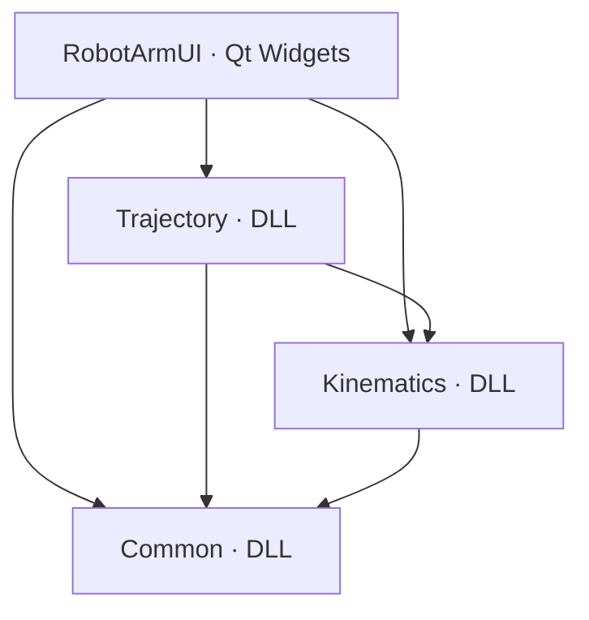

# 架构与接口约定

本仓库按根目录《面向对象作业设计.md》初始化，参考 FaceDetection 的原生 VS DLL、公共属性表和 Qt `.pro` 组织方式。当前交付是可编译、可启动的协作骨架。

## 模块与依赖

| 模块 | 职责 | 负责人 |
| --- | --- | --- |
| RobotArmUI | 参数输入、计算操作、机械臂绘制、轨迹展示、动画播放 | 界面开发者 |
| Common | 公共结构体与 RobotArm 状态；同步维护文档和接口 | 运动学开发者牵头，三人评审 |
| Kinematics | 正运动学、两种逆运动学接口及几何边界处理 | 运动学开发者 |
| Trajectory | 关节空间与笛卡尔直线轨迹、采样及失败处理 | 轨迹规划开发者 |

Common 不依赖 Kinematics，避免循环依赖。RobotArm 在长度或角度变化时计算基础连杆几何位置；ForwardSolve 复用这个入口。完整三参数 SetPara 按原设计保存调用者提供的状态。

## 初始化范围

- Common 的状态访问、自动位置更新及正运动学基础路径已实现，以便验证跨 DLL 调用。
- 两个 InverseSolve 目前返回 false，保持输出角度不变；由运动学负责人实现。
- 两个规划入口目前清空 result 并返回 false；由轨迹负责人实现。
- Qt 界面包含 Designer 主窗口、原设计中的成员和槽函数，显示模块状态；操作和动画由界面负责人实现。
- 骨架检查只验证初始化契约，不代表逆运动学或轨迹算法已经完成。负责人实现后需相应扩充测试。

## 构建契约

- Windows x64、VS 2022 v143、C++17、Qt 6.11.2 MSVC 2022 x64。
- Debug 使用 /MDd，Release 使用 /MD；不支持混用 MinGW DLL 或不同配置的 STL 对象。
- DLL 的 `__declspec(dllexport/dllimport)` 宏放在各模块 Export.h，只有生产项目定义对应 `_EXPORTS`。
- commonlibdll/BuildSettings.props：C++、编码、CRT、公共输出根目录。
- commonlibdll/LibraryOutput.props：统一 DLL、LIB、PDB、头文件发布位置。
- commonlibdll/RobotArmLib.props：公共 include/lib 搜索路径、按依赖选择导入库、自动复制运行 DLL。
- 公共输出布局为 `<模块>/include`、`<模块>/lib/x64/<配置>`、`<模块>/bin/x64/<配置>`。隔离 Debug/Release，避免覆盖。
- 模块项目引用负责构建顺序；props 负责导入与输出。库项目禁止自动链接全部库，防止自引用和循环依赖。
- Common/Common.sln、Kinematics/Kinematics.sln、Trajectory/Trajectory.sln 是独立的库开发入口，分别包含目标库及其完整依赖项目。它们只引用现有 vcxproj，不复制工程，也不依赖 Qt；均纳入 Git。
- RobotArmUI.pro 是界面工程来源；生成脚本调用 Qt qmake 的 VS 生成器，随后注入公共 props 和原生库项目引用。界面 vcxproj 含本机 Qt 路径，不提交 Git。根解决方案和 RobotArmUI/RobotArmUI.sln 只含稳定的相对路径和项目 GUID，均纳入 Git；界面项目需先在本机生成再打开。
- 各解决方案使用同一组公共输出目录；不要并发构建同一配置。新增项目或改变依赖关系时，需同步独立解决方案的项目列表和配置映射。
- 代码和头文件只在模块源码目录编辑，commonlibdll/include 中的副本由编译发布，不提交。

## 算法接口约定

保留原设计的类型名、方法名、参数顺序。`TRAJECTORY` 使用 `using` 别名替代宏，调用方式一致。长度与坐标使用同一长度单位，角度使用弧度，时间使用秒，默认连杆长度为 100、100，角度为 0、0。

逆解失败不覆盖 result；规划失败清空 result；规划只读取机械臂。规划成功时包含起终点，duration 和 timeStep 都必须大于零且有限。具体构型、奇异位形和采样策略由负责人补充测试后实现，不在骨架中伪装成功。

Qt 不进入三个库的公共接口。当前 C++ DLL 接口传递 std::vector，成员必须统一 MSVC 工具集、架构、Qt 版本及 CRT 配置。
